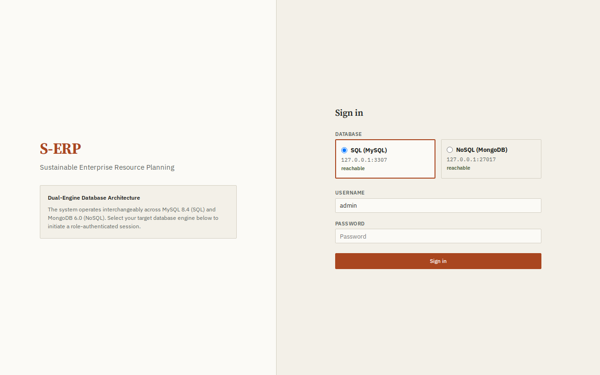
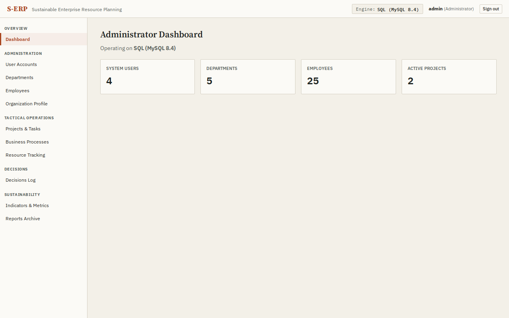
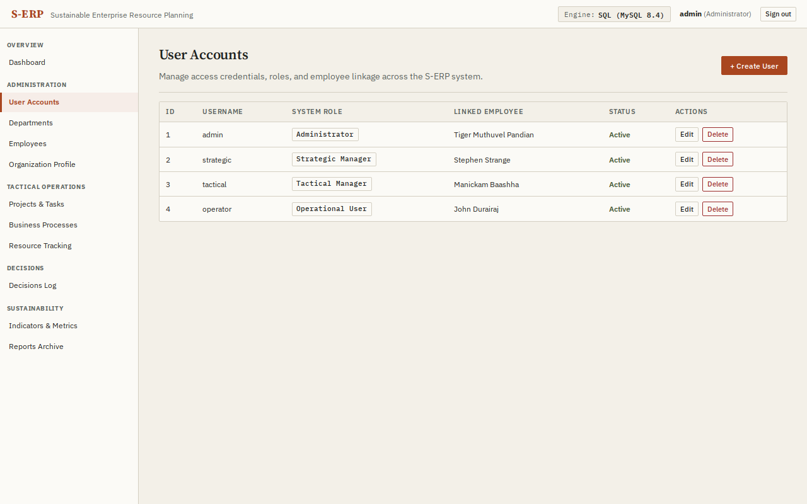
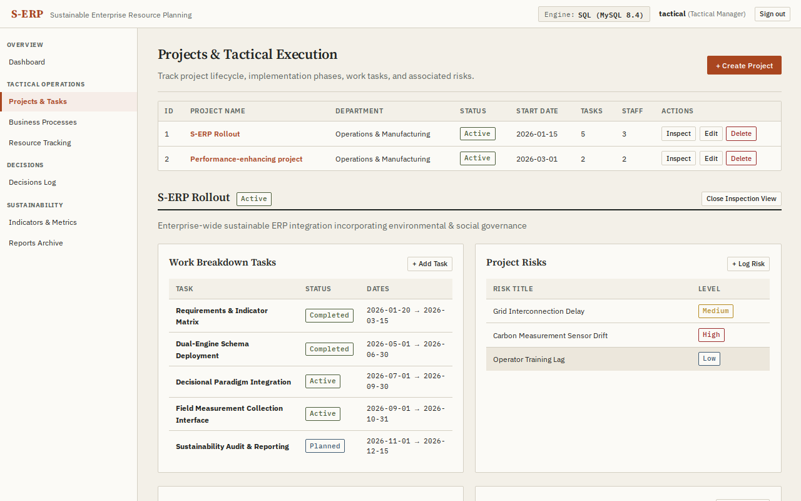
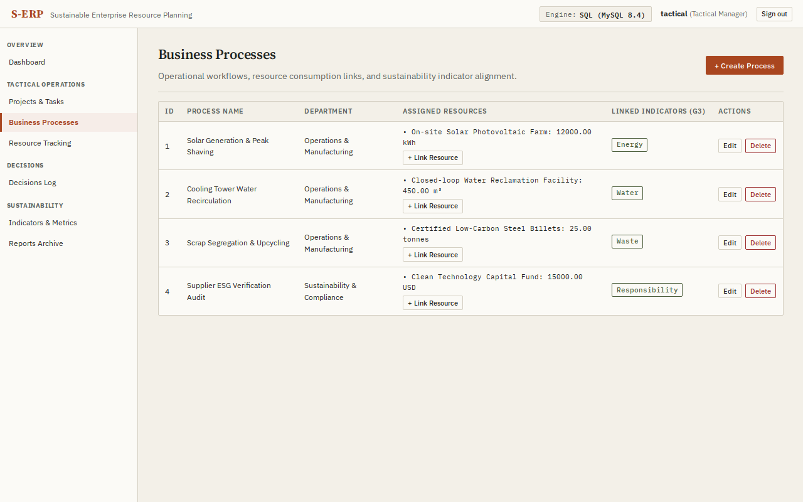
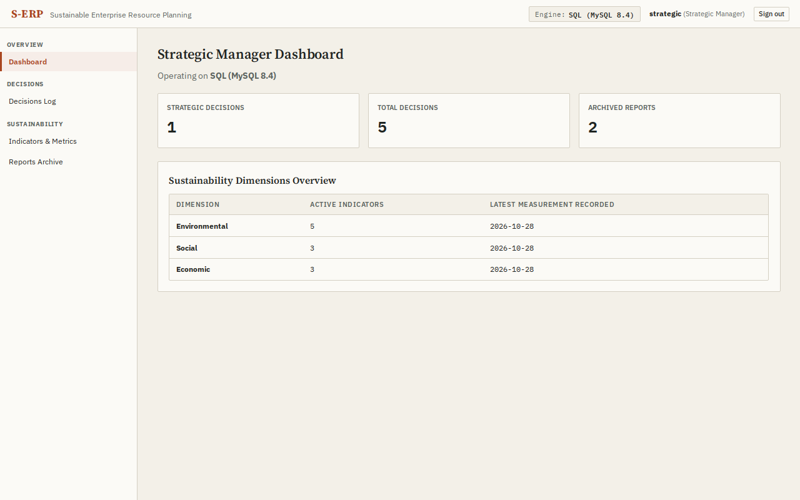
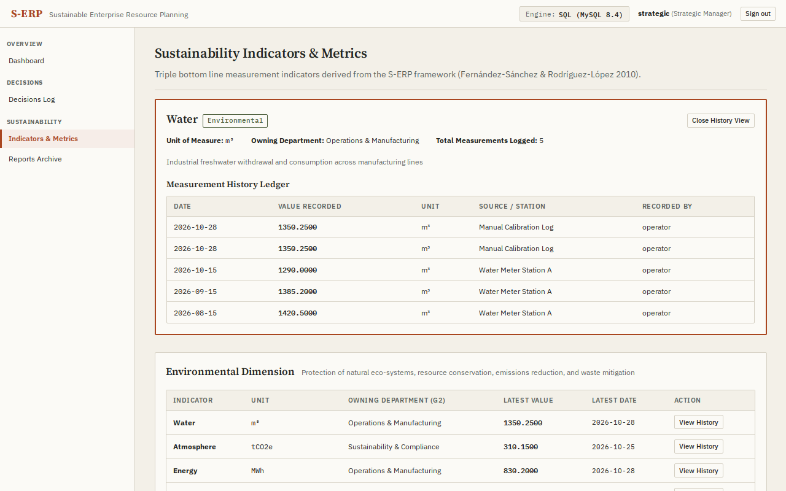
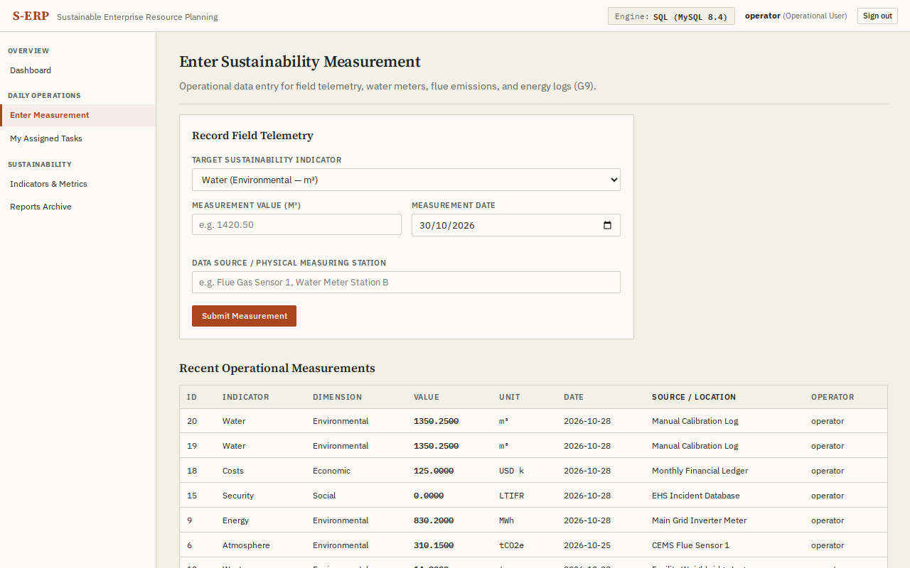

# S-ERP Prototype System Reference & User Manual

**Project:** Sustainable Enterprise Resource Planning (S-ERP) DBMS  
**Scope:** Complete Prototype System (Milestones P0–P4)  
**Branch:** `{{GIT_BRANCH}}`  
**Commit:** `{{GIT_COMMIT}}`  
**Date:** {{DATE}}  
**Engines Verified:** SQL (MySQL 8.4) & NoSQL (MongoDB 6.0)  

---

## 1. Executive Summary

This report documents the functional base prototype of the **Sustainable Enterprise Resource Planning (S-ERP)** database system, developed in alignment with *Sustainable enterprise resource planning systems implementation: A framework development* (Chofreh, Goni, Klemeš, 2018) and the domain ER and Use Case specifications.

The application demonstrates:
1. **Dual Database Architecture (SQL & NoSQL):** Operates interchangeably across relational **SQL (MySQL 8.4)** and document **NoSQL (MongoDB 6.0)**. The user selects the engine upon signing in, and subsequent transactions run strictly against that engine's driver and storage model without cross-contamination.
2. **Strict Dual-Paradigm Conformance:**
   - **Sustainability Paradigm:** Direct tracking across **Environmental**, **Social**, and **Economic** dimensions based on the Fernández-Sánchez & Rodríguez-López indicator taxonomy.
   - **Decisional Paradigm:** Three-tier decisional hierarchy (**Strategic**, **Tactical**, **Operational**) enforced strictly at the database and application levels.
3. **Complete Relational Model:** All 17 tables from the ER diagram plus 4 gap/bridge tables (21 total tables) with complete foreign key indexes and check constraints.
4. **Field-Notebook Ledger Interface:** Clean, dense, practical user experience avoiding generic template patterns, gradients, and bloated cards.

---

## 2. Who Can Do What (RBAC Capability Matrix)

The application implements four distinct user roles derived directly from the S-ERP use case diagram. Server-side middleware validates every request.

| Capability / Function | Administrator | Strategic Manager | Tactical Manager | Operational User |
|---|:---:|:---:|:---:|:---:|
| **Select Database Engine (MySQL / MongoDB)** | ✔ | ✔ | ✔ | ✔ |
| **Authenticate & Sign In** | ✔ | ✔ | ✔ | ✔ |
| **View Role-Specific Home Dashboard** | ✔ | ✔ | ✔ | ✔ |
| **Manage User Accounts & Reset Passwords** | ✔ | ✖ | ✖ | ✖ |
| **Manage Departments & Hierarchies** | ✔ | ✖ | ✖ | ✖ |
| **Manage Employee Records** | ✔ | ✖ | ✖ | ✖ |
| **Update Organization Profile & Focus Dimensions** | ✔ | ✖ | ✖ | ✖ |
| **Create New Sustainability Indicators** | ✔ | ✖ | ✖ | ✖ |
| **View Sustainability Indicators & History Ledgers** | ✔ | ✔ | ✔ | ✔ |
| **Record Strategic Decisions** | ✔ | ✔ | ✖ (403) | ✖ (403) |
| **Record Tactical Decisions** | ✔ | ✖ (403) | ✔ | ✖ (403) |
| **Manage Projects (Tasks, Phases, Staff Members)** | ✔ | ✖ (403) | ✔ | ✖ (403) |
| **Log Project Risks & Severity Levels** | ✔ | ✖ (403) | ✔ | ✖ (403) |
| **Manage Business Processes & Resource Allocations** | ✔ | ✖ (403) | ✔ | ✖ (403) |
| **Track Resources (Energy, Water, Material, Financial)** | ✔ | ✖ (403) | ✔ | ✖ (403) |
| **Generate & Archive Reports** | ✔ | ✔ | ✔ | ✖ (403) |
| **View Archive Reports** | ✔ | ✔ | ✔ | ✔ |
| **Enter Field Telemetry & Measurements (G9)** | ✔ | ✖ (403) | ✖ (403) | ✔ |
| **View Assigned Personal Work Tasks** | ✖ | ✖ | ✖ | ✔ |

### Detailed Role Responsibilities

#### 1. Administrator (`admin`)
- **System Custodian:** Has absolute authority over the foundational data layer.
- **Responsibilities:** Configures user credentials, assigns system roles, links user accounts to employee personnel, manages organizational hierarchy (preventing orphaned records), and establishes enterprise-wide dimension alignment.

#### 2. Strategic Manager (`strategic`)
- **Executive Governance:** Focuses on long-range sustainability posture and top-tier policy.
- **Responsibilities:** Evaluates triple-bottom-line performance across all three dimensions, records **Strategic** decisions (e.g. system architecture adoption, decarbonization commitments), and monitors regulatory compliance reports. Restricted from making tactical/operational modifications.

#### 3. Tactical Manager (`tactical`)
- **Operational Planning & Delivery:** Translates strategic goals into actionable execution.
- **Responsibilities:** Oversees the S-ERP implementation project, configures roadmap phases (Pre-implementation, Implementation, Post-implementation), creates and schedules project tasks, logs project risks, allocates staff members, and manages business processes and their resource consumption. May only log **Tactical** decisions.

#### 4. Operational User (`operator`)
- **Frontline Data Capture:** Serves as the primary data ingestion agent for physical systems.
- **Responsibilities:** Captures daily measurements (meter readings, flue telemetry, water consumption, waste weighbridge logs) stamped with their identity (`recorded_by`). Reviews work breakdown tasks explicitly assigned to them via project staffing.

---

## 3. Complete User Manual

### 3.1 Authentication & Engine Selection

1. Open your browser and navigate to `http://localhost:3000`.
2. Inspect the **Database Engine** selector above the credentials form:
   - **SQL (MySQL):** Connects to the MySQL 8.4 engine on port 3307.
   - **NoSQL (MongoDB):** Connects to the MongoDB 6.0 document engine on port 27017.
   - Each option displays live reachability status probed from `/api/engines/status`.
3. Select your desired engine by clicking the respective radio panel.
4. Enter your username and password:
   - Administrator: `admin` / `Admin#2026`
   - Strategic Manager: `strategic` / `Strat#2026`
   - Tactical Manager: `tactical` / `Tact#2026`
   - Operational User: `operator` / `Oper#2026`
5. Click **Sign in**. Upon successful authentication, your session cookie is created and the main application shell displays your permanent database engine badge in the top right header.

---

### 3.2 Administrator Operations Manual

#### Managing User Accounts
1. In the sidebar under **Administration**, click **User Accounts**.
2. To create a user:
   - Click **+ Create User**.
   - Input username, password (minimum 6 characters), assign the role, select the linked employee record, and verify the active checkbox.
   - Click **Save User**.
3. To edit or reset credentials:
   - Click **Edit** next to any user. Enter a new password to reset the hash, or leave it blank to retain the current password.
4. To deactivate or delete:
   - Toggle the active state to deactivate without deleting, or click **Delete** to permanently purge the user.

#### Managing Departmental Structure
1. In the sidebar, click **Departments**.
2. Click **+ Create Department**.
3. Specify department name, optional parent department (for organizational hierarchy), and description. Click **Save Department**.
4. **Foreign Key Integrity Check:** If you attempt to delete a department that contains active employees or child departments, the system rejects the operation with a descriptive `409 Conflict` error dialog. Reassign employees before deletion.

#### Managing Employees
1. In the sidebar, click **Employees**.
2. Click **+ Create Employee**.
3. Provide the employee's full name, corporate email address, job title/role, and assigned department. Click **Save Employee**.

#### Organization Profile & Strategic Dimension Focus
1. In the sidebar, click **Organization Profile**.
2. Update the enterprise legal name, headquarters address, and operating description.
3. Under **Strategic Sustainability Focus Areas (G1)**, check or uncheck dimensions (**Environmental**, **Social**, **Economic**).
4. Click **Save Profile Changes**.

---

### 3.3 Strategic Manager Operations Manual

#### Executive Dashboard
1. Sign in as `strategic`. The home screen displays real-time counts of strategic decisions, total enterprise decisions, and archived reports.
2. The **Sustainability Dimensions Overview** table summarizes active indicators per dimension and the timestamp of the most recent field measurement.

#### Reviewing Sustainability Metrics
1. Click **Indicators & Metrics** in the sidebar.
2. Browse indicators grouped by dimension (**Environmental**, **Social**, **Economic**).
3. Review the latest measured values, units, and owning departments.
4. Click **View History** on any indicator to open the **Measurement History Ledger**, displaying every recorded telemetry entry with timestamps, exact decimal readings, physical sensor stations, and recording operators.

#### Recording Strategic Governance Decisions
1. In the sidebar, click **Decisions Log**.
2. Click **+ Log Decision**.
3. The **Decisional Paradigm Level** is pre-locked to **Strategic**.
4. Enter the decision title, effective date, optional project link, and description.
5. Under **Associated Risks (G5)**, check any identified risks this strategic decision mitigates.
6. Click **Save Decision**.

---

### 3.4 Tactical Manager Operations Manual

#### Project Lifecycle & Roadmap Management
1. In the sidebar, click **Projects & Tasks**.
2. The master projects table lists active initiatives with start/end dates, task totals, and staffing counts.
3. Click **Inspect** on `S-ERP Rollout` to open the integrated project breakdown:
   - **Work Breakdown Tasks:** View scheduled tasks. Click **+ Add Task** to append a new task with start/end dates and status (`Planned`, `Active`, `Completed`).
   - **Project Risks:** Click **+ Log Risk** to record a threat with severity (`Low`, `Medium`, `High`).
   - **Implementation Roadmap Phases:** View the chronological progression (`Pre-implementation` → `Implementation` → `Post-implementation`).
   - **Assigned Staff:** Click **+ Assign Staff** to allocate an employee to the project with their dedicated project role and allocation percentage.

#### Business Processes & Resource Tracking
1. In the sidebar, click **Business Processes**.
2. Review operational processes, owning departments, and linked sustainability indicators (**G3**).
3. To allocate materials or energy:
   - Click **+ Link Resource** on a process.
   - Select the resource (e.g. `Main Solar Array`, `Water Reclamation`), enter the numeric quantity, and specify unit. Click **Assign Resource**.
4. In the sidebar, click **Resource Tracking** to view or create physical assets across **Energy**, **Water**, **Material**, and **Financial** classifications.

#### Recording Tactical Decisions
1. In the sidebar, click **Decisions Log**.
2. Click **+ Log Decision**. The level is locked to **Tactical**. Link the decision to active projects, processes, and project risks.

---

### 3.5 Operational User Operations Manual

#### Entering Field Telemetry & Measurements
1. Sign in as `operator`.
2. In the sidebar under **Daily Operations**, click **Enter Measurement**.
3. In the entry form:
   - Select the **Target Sustainability Indicator** from the dropdown (e.g. `Water`, `Atmosphere`, `Energy`).
   - Enter the numeric **Measurement Value** (the input label dynamically indicates the indicator's measurement unit).
   - Enter the **Measurement Date**. *(Note: Future dates are strictly disallowed by client and server validation).*
   - Enter the **Data Source / Station** (e.g. `Flue Gas Sensor A`, `Weighbridge 2`).
4. Click **Submit Measurement**.
5. The measurement is immediately recorded in the database with `recorded_by` pointing to your user account (**G9**), and appears at the top of the **Recent Operational Measurements** table.

#### Reviewing Assigned Tasks
1. In the sidebar, click **My Assigned Tasks**.
2. Review the list of project tasks assigned to your employee account through project staffing, including status, project title, and target completion dates.

---

## 4. Scope Check & Milestone Verification

| Prototype Item | Milestone Origin | Status | Verification Evidence |
|---|---|:---:|---|
| Dual Schemas / Models (MySQL 8.4 & MongoDB 6.0) | P1 (M1) | **Done** | `db/mysql/schema.sql` (21 tables) and MongoDB (21 collections) |
| Idempotent Seed Script with Demo Accounts | P1 (M1+M2) | **Done** | `scripts/seed.ts` seeds identical data, demo accounts with bcrypt cost 12 |
| Live ER Conformance & Row Parity Check | P1 (M1) | **Done** | `scripts/er-check.ts` passes 21/21 tables with matching counts |
| Database Adapter with Placeholder Translation | P1 (M2) | **Done** | `server/src/db/adapter.ts` handles `?` ↔ `$n` and pool isolation |
| Signed Session Cookie Authentication | P1 (M2) | **Done** | `server/src/auth/` HMAC-SHA256 tokens in `httpOnly` cookie |
| Field-Notebook App Shell & Tokens | P2 (M3) | **Done** | Handcrafted CSS (`tokens.css`, `base.css`), no gradients, no emoji icons |
| Engine Selector Login Page | P2 (M3) | **Done** | `LoginPage.tsx` with live health check from `/api/engines/status` |
| Role-Filtered Sidebar Navigation | P2 (M3) | **Done** | `Sidebar.tsx` displays role-authorized sections only |
| Administrator CRUD (Users, Depts, Emps, Org) | P3 (M4) | **Done** | Full CRUD; 409 conflict check on deleting depts with staff |
| Tactical CRUD (Projects, Tasks, Phases, Risks) | P3 (M5) | **Done** | Project inspection view, tasks, phases, risks, member allocation |
| Processes & Resource Tracking | P3 (M7) | **Done** | Process CRUD, process-resource allocation, G3 indicator linking |
| Decisional Paradigm Logging (Role Validated) | P3 (M7) | **Done** | Role level validation (403 on violations), G5 risk links |
| Sustainability Indicators & History Ledgers | P3 (M6) | **Done** | Grouped by dimension, G2 dept links, historical measurement table |
| Operational Measurement Entry | P3 (M6) | **Done** | Form with future date validation, auto-assigns `recorded_by` (G9) |
| Role-Specific Live Home Dashboards | P4 (M8) | **Done** | `GET /api/dashboard` aggregated metrics tailored per role |
| Full Quality Check (`npm run check`) | P4 (M9) | **Done** | 0 TypeScript errors, 0 ESLint errors, 23/23 tests passed |

---

## 5. Visual Evidence & Application Screenshots

The following real screenshots were captured from the running application on `http://localhost:3000`.

### 5.1 Sign In Screen & Database Engine Selector

*Figure 1: Sign in screen showing dual-engine selector with live host:port and reachability status.*

---

### 5.2 Administrator Dashboard & User Management

*Figure 2: Administrator dashboard displaying real-time system counts on PostgreSQL 16.*


*Figure 3: User Accounts ledger table with system roles, employee linkage, and status tags.*

---

### 5.3 Tactical Project & Process Management

*Figure 4: Tactical project inspection view displaying work breakdown tasks, risks, phases, and staff.*


*Figure 5: Business processes table with assigned resources and linked sustainability indicators (G3).*

---

### 5.4 Strategic Overview & Sustainability Metrics

*Figure 6: Strategic Manager dashboard summarizing sustainability dimensions and governance decisions.*


*Figure 7: Sustainability indicator history ledger displaying time-series measurements with sensors and operators.*

---

### 5.5 Operational Measurement Entry

*Figure 8: Operational measurement form validating field telemetry with date checks and operator audit trail.*

---

## 6. Live Test Evidence & Engine Parity Output

### 6.1 Schema & Row Parity Verification (`npm run er-check`)
```text
=== S-ERP Schema & Conformance Check (SQL vs NoSQL) ===

Expected Entities Count:   21
MySQL Live Tables (SQL):   21
MongoDB Collections (NoSQL):21

| Entity Name               | MySQL (SQL) | MongoDB (NoSQL) | Row / Doc Count (My / Mg) | Status |
|---|:---:|:---:|:---:|:---:|
| organization              | ✔ | ✔ | 1 / 1 | PASS |
| department                | ✔ | ✔ | 5 / 5 | PASS |
| employee                  | ✔ | ✔ | 25 / 25 | PASS |
| app_user                  | ✔ | ✔ | 4 / 4 | PASS |
| project                   | ✔ | ✔ | 2 / 2 | PASS |
| project_task              | ✔ | ✔ | 7 / 7 | PASS |
| employee_project          | ✔ | ✔ | 5 / 5 | PASS |
| sustainability_dimension  | ✔ | ✔ | 3 / 3 | PASS |
| sustainability_indicator  | ✔ | ✔ | 11 / 11 | PASS |
| indicator_measurement     | ✔ | ✔ | 20 / 20 | PASS |
| resource                  | ✔ | ✔ | 6 / 6 | PASS |
| business_process          | ✔ | ✔ | 4 / 4 | PASS |
| process_resource          | ✔ | ✔ | 4 / 4 | PASS |
| decision                  | ✔ | ✔ | 5 / 5 | PASS |
| risk                      | ✔ | ✔ | 3 / 3 | PASS |
| implementation_phase      | ✔ | ✔ | 5 / 5 | PASS |
| report                    | ✔ | ✔ | 2 / 2 | PASS |
| organization_dimension    | ✔ | ✔ | 3 / 3 | PASS |
| process_indicator         | ✔ | ✔ | 4 / 4 | PASS |
| decision_risk             | ✔ | ✔ | 1 / 1 | PASS |
| phase_report              | ✔ | ✔ | 2 / 2 | PASS |

------------------------------------------------------------
RESULT: ER & Conformance PASSED across SQL (MySQL) and NoSQL (MongoDB).
------------------------------------------------------------
```

### 6.2 Full Quality Suite Verification (`npm run check`)
```text
> s-erp-dbms@0.1.0 check
> npm run typecheck && npm run lint && npm run test

> s-erp-dbms@0.1.0 typecheck
> node node_modules/typescript/bin/tsc --noEmit && node node_modules/typescript/bin/tsc -p server/tsconfig.json --noEmit

> s-erp-dbms@0.1.0 lint
> node node_modules/eslint/bin/eslint.js . --ext .ts,.tsx --quiet

> s-erp-dbms@0.1.0 test
> vitest run

 ✓ tests/server.test.ts (2 tests)
 ✓ tests/auth.test.ts (7 tests)
 ✓ tests/modules.test.ts (14 tests)

 Test Files  3 passed (3)
      Tests  23 passed (23)
   Duration  5.81s
```

---

## 7. Deviations & Design Decisions (G1–G9)

| Gap ID | Diagram Situation | Implemented Resolution | Rationale & Tradeoffs |
|---|---|---|---|
| **G1** | Organization focuses on Sustainability Dimension | Created `organization_dimension(org_id, dimension_id)` bridge table | Allows an organization to explicitly declare which of the 3 dimensions it targets. |
| **G2** | Department belongs to Sustainability Indicator | Added nullable `department_id` FK on `sustainability_indicator` | Permits indicators to be owned by a functional department while allowing enterprise-shared metrics. |
| **G3** | Process relates to Sustainability Indicator | Created `process_indicator(process_id, indicator_id)` bridge table | Directly links business workflows to the environmental/social indicators they influence. |
| **G4** | Decision makes Business Process | Added nullable `process_id` FK on `decision` | Enables operational and tactical decisions to tie back to specific workflow changes. |
| **G5** | Decision associated with Risk | Created `decision_risk(decision_id, risk_id)` bridge table | Supports many-to-many associations between corrective decisions and project risks. |
| **G6** | Risk has Implementation Phase | Relate through common `project_id` parent | Both entities already point to `project`; avoids redundant FK cycles. |
| **G7** | Phase generates Report | Created `phase_report(phase_id, report_id)` bridge table | Models project audit reports generated at specific phase milestones. |
| **G8** | Users & Roles in Use Case diagram but not ER | Created `app_user` table with `app_role` check constraint | Implements secure authentication without contaminating core HR employee data. |
| **G9** | Operational User enters daily data without author | Added nullable `recorded_by` FK (→ `app_user`) on `indicator_measurement` | Guarantees an immutable audit trail for all physical measurements. |

---

## 8. Database Architecture Differences: Relational (SQL) vs Document (NoSQL)

| Architecture Dimension | Relational SQL (MySQL 8.4) | Document NoSQL (MongoDB 6.0) | S-ERP Adapter Resolution |
|---|---|---|---|
| **Data Representation** | Rigid relational 2D tables with foreign key constraints | Flexible BSON document collections | Documents retain integer ID fields (`org_id`, `emp_id`) and unique indexes mirroring foreign keys. |
| **Primary Key Generation** | Relational `AUTO_INCREMENT` integer counter | Atomic document sort (`find().sort({ [pk]: -1 })`) | `insert()` dynamically determines max integer ID to guarantee integer identifier parity across engines. |
| **Cross-Entity Joins** | Native relational `JOIN` operations | In-memory relational join layer over MongoDB collections | `MongoAdapter` extracts matching collection documents into memory and computes relational joins via SQL engine. |
| **Data Mutability** | Structured `INSERT`, `UPDATE`, `DELETE` statements | Native MongoDB driver calls (`insertOne`, `updateMany`, `deleteMany`) | `MongoAdapter.execute()` routes mutations to native collection methods, persisting live state changes. |
| **Telemetry & Time Series** | Strict `DATETIME` columns with index on `measurement_date` | Date strings and BSON epoch timestamps | Standardized ISO-8601 strings stored in MongoDB documents; converted to timestamps for max date aggregation. |

---

## 9. How to Run and Verify from Clean Clone

```bash
# 1. Clone repository and set up environment
git clone <repo-url> serp-dbms
cd serp-dbms
cp .env.example .env

# 2. Start database containers
docker compose up -d

# 3. Install dependencies
npm install --ignore-scripts

# 4. Migrate and seed both database engines
npm run migrate
npm run seed

# 5. Verify live ER conformance and row count parity
npm run er-check

# 6. Execute full quality checks (typecheck + lint + tests)
npm run check

# 7. Build production bundle and start server
npm run build
npm run dev:server
```
Open **`http://localhost:3000`** in your browser.
Select either **SQL (MySQL)** or **NoSQL (MongoDB)** to sign in.
